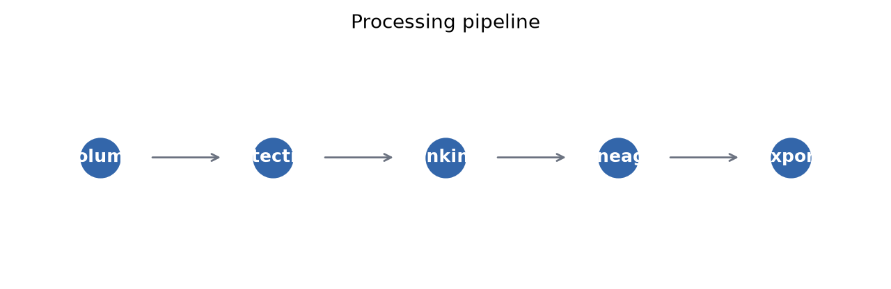

# Summary

Three-dimensional time-lapse fluorescence microscopy is widely used to study embryonic development, but reconstructing cell positions and lineage relationships from volumetric data remains difficult because of anisotropic sampling, crowding, motion, and division.
Biohub Cell Lineage Tracker is an open-source Python package and Streamlit application that detects cell centroids in each 3D frame, links them across time with a multi-cue linear assignment solver, and infers mitosis when one parent associates with two nearby daughters.
The same analysis core serves batch scripts and a browser UI for inspecting volumes, overlays, montages, lineage graphs, and CSV/JSON exports.
The implementation prioritizes interpretable classical image processing while exposing a detector interface for future learned segmenters.

# Statement of need

Live imaging produces sequences $I_t(z,y,x)$ whose manual lineage tracing is accurate but slow at scale.
Automated workflows must detect centroids in anisotropic volumes, associate them across time, and emit a directed graph $G=(V,E)$ with nodes $(t,z,y,x)$ and edges for continuations or divisions.

Biohub Cell Tracking During Development uses Zarr volumes and sparse GEFF labels; researchers need tunable parameters, slice-level review, and exports suitable for publications—not only a batch CSV writer.
TrackMate excels in Fiji/ImageJ but does not bundle this Zarr catalog workflow; Cellpose can improve detection when retraining is feasible, yet sparse-label benchmarks still rely on classical baselines.
Biohub Cell Lineage Tracker connects inspection, execution, and export in one documented Python stack.

# State of the field

TrackMate [@tinevez2017trackmate], lineaging pipelines [@amat2014lineage], and deep segmenters [@stringer2021cellpose; @cicek20163dunet] address parts of the problem; scikit-image peaks and Hungarian assignment underpin many classical trackers [@van2014scikit; @kuhn1955hungarian].
Streamlit enables rapid review UIs [@streamlit2019].
This repository **builds** an integrated Python 3 stack—library modules, Streamlit front end, tuning scripts, and a notebook builder—around one configuration object and a single `run_tracking_pipeline` entry point for Biohub Zarr/GEFF data.

# Software design

## Problem formulation and configuration

Volumes are stored as uint16 Zarr arrays with shape $(T,Z,Y,X)$ and anisotropic voxel spacing $s_z=1.625\,\mu\mathrm{m}$, $s_y=s_x=0.40625\,\mu\mathrm{m}$.
Optional training annotations live in GEFF graph directories with sparse centroid labels; a missing label does not imply absence of a cell.
Hyperparameters for detection, linking, division gates, and optional competition presets live in a central `Config` type (see `docs/DEVELOPMENT.md` for field-level settings).
The `competition_v4_preset()` matches the classical submission path documented in `EXPERIMENTS.md`.

## Detection pipeline

Detection operates per frame on a laterally downsampled grid: block mean pooling in $Y$ and $X$ preserves full axial resolution while making the search grid approximately isotropic in micrometers.
The default path Gaussian-smooths the downsampled volume; an optional difference-of-Gaussians band-pass front-end exists for experiments but is not the Streamlit default.

Candidate peaks use scikit-image local maxima (with a fallback filter) on a thresholded map.
The absolute threshold is the maximum of Otsu’s method and a relative-rise rule $\tau = b + \alpha(h-b)$, where $b$ is the median intensity, $h$ is a high percentile of the smoothed map, and $\alpha$ is a configurable relative coefficient.
A secondary dense-cluster pass can repeat peak finding at a lower relative threshold to recover nearby cells.
Peaks are mapped to full resolution, refined by intensity-weighted centroids, filtered by contrast and border rules, and merged by physical non-maximum suppression in micrometers.
Adaptive threshold retries and per-frame count caps are available but disabled in the competition preset when they conflicted with submission density targets.

Design trade-off: dual-threshold peak finding and physical NMS improve recall in crowded anisotropic volumes without adopting a learned segmenter, at the cost of sensitivity to bright artifacts and parameter tuning.

## Temporal linking

Consecutive frames are associated by solving a linear assignment problem on detections expressed in physical coordinates.
When rich linking is enabled, the cost combines Euclidean distance, a motion residual from the previous displacement, normalized intensity difference, and a neighborhood offset signature; pairs beyond a maximum link distance receive a prohibitive cost.
The Hungarian algorithm (`scipy.optimize.linear_sum_assignment`) yields one-to-one matches, and velocities update along accepted edges for the next frame.
The pipeline streams one time point at a time to limit memory on large Zarr volumes.
Optional gap closing and soft orphan pruning exist but are off in the competition preset after internal experiments linked them to lower public leaderboard scores.

## Division inference

After primary assignment, unmatched detections may become second daughters of a parent that already has exactly one matched child.
Candidates must pass parent–daughter and sister distance gates and, by default, a midpoint gate placing the parent near the sisters’ midpoint in micrometers.
The rule limits fan-out and favors symmetric mitoses; oblique or overlapping divisions remain a known weakness.
Post-processing can prune isolated nodes that never participate in an edge.

## Architecture and interactive application

Core libraries under `src/biohub/` implement I/O, detection, tracking, analysis, export, and Matplotlib visualization; `app.py` hosts Streamlit.
Seven pages—Home, Dataset, Volume, Pipeline, Detection, Lineage, and Exports—share one pipeline runner.
Users load local `train/`/`test` Zarr/GEFF catalogs, the bundled synthetic demo, or an uploaded $(T,Z,Y,X)$ NumPy volume; adjust analysis sliders; run preview or full sequences; and download CSV/JSON exports.

Figure @fig:streamlit-ui shows the **Detection** and **Lineage** pages after a pipeline run.
On Detection, users scrub time and $z$ to review centroid overlays, inter-frame link blends, a temporal montage, and an optional GIF export.
On Lineage, users inspect the topology graph, a track timeline, and a table of inferred division events—supporting qualitative audit before export.
The companion IEEE manuscript (`paper/main.tex`) documents the same UI layout in greater figure detail.

![Streamlit Detection and Lineage pages. (a) Detection overlay and inter-frame links. (b) Lineage topology, track timeline, and division-event table. Screenshots extracted from the author’s IEEE manuscript PDF (Fig. 2 panels c–d); the sidebar shows the **Synthetic demo** data source with default analysis sliders. []{label="fig:streamlit-ui"}](figures/joss_streamlit_detection_lineage.png)

## Exports and reproducibility

Exports provide a merged CSV (`row_type` node or edge) and a JSON graph with parallel node and edge lists.
Seven pytest cases on deterministic Gaussian-blob phantoms verify detection, linking, division topology, and export round-trips (`tests/`, `docs/REPRODUCIBLE_EXAMPLE.md`).
Figure scripts and GitHub Actions on the `joss-preparation` branch compile this paper and run the test suite.

## Limitations

Classical peak detection can under-segment dense clusters and over-detect bright structures near tissue boundaries.
Greedy frame-to-frame linking does not recover long occlusions unless optional gap closing is enabled.
Division inference is heuristic.
A learned-detector hook exists but no pretrained weights ship with the repository.
The IEEE companion text describes additional planned methods (e.g., watershed splitting) not yet implemented; qualitative zebrafish-style figures require user-downloaded Biohub volumes not redistributed here.

# Research impact statement

The developer used this software in the Biohub Cell Tracking During Development challenge on Kaggle.
The author reports an author-verified **public leaderboard score of 0.659** with the classical v4/v7 preset (`EXPERIMENTS.md`).
That value is the competition’s public scoring metric—not classification accuracy, independent validation, or evidence of superiority over other methods.
Seven automated pytest cases verify core pipeline behaviour on synthetic data separately from competition scoring.
A public Streamlit demo (`README.md`) supports inspection without a local install, and reproducible figure-generation scripts accompany the IEEE-format methods write-up in `paper/main.tex`.

# AI usage disclosure

Generative AI in **Cursor** (Cloud Agent / Composer) assisted the `joss-preparation` branch: JOSS documentation review, pytest suites, drafting and revising `paper.md`, figure extraction from the author’s IEEE PDF, CI configuration, and a JSON export fix found by tests.
Technical descriptions draw on `src/biohub/`, repository docs, and the companion IEEE manuscript.
The author verified the public competition score in their own Kaggle account; the agent did not access that account.
This disclosure does not state that earlier project work avoided AI tools or that every AI-assisted passage was line-by-line re-validated by the author.

# Acknowledgements

The author thanks the Biohub Cell Tracking During Development organizers and community participants for dataset specifications and leaderboard feedback that informed competition presets in this repository.

# References
